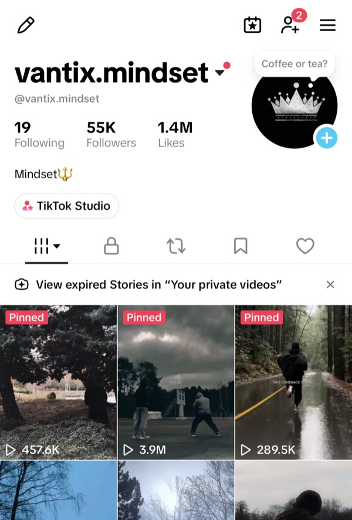
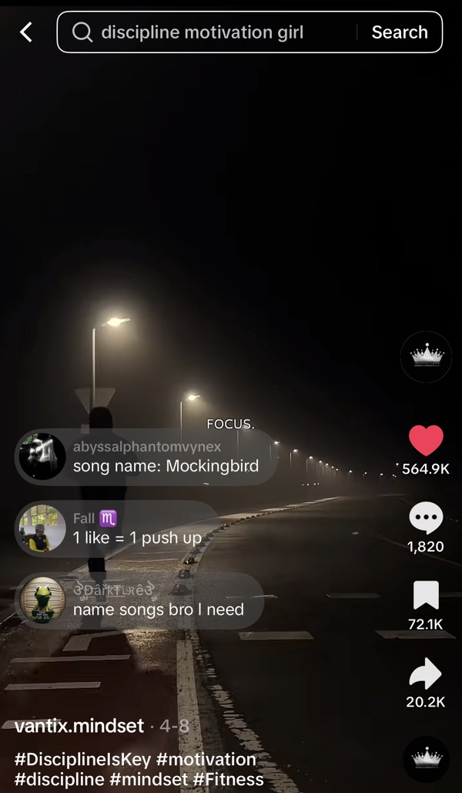
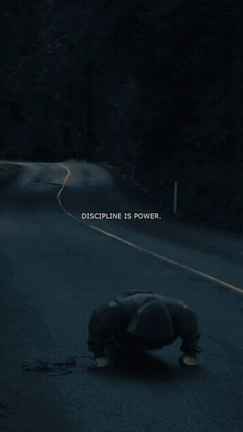

# TikTok Automation Experiment

**Can a fully automated, faceless TikTok account grow from zero?** I researched which TikTok video formats can be produced automatically, picked the one that was the easiest to generate *and* still got high views, automated it end to end, and tested it on a brand-new account.

## Results

**Zero ad budget. Fully automated. Faceless videos only.** Every video was generated and uploaded by the code in this repo, with no paid promotion, no filming and no manual editing.

| | First ~6 weeks (3 videos / day) | Today |
|---|:---:|:---:|
| Followers | **45K** | **55K** |
| Likes | **1M** | **1.4M** |
| Best video | | **3.9M views** · 565K likes · 72K saves · 20K shares |

Account: [@vantix.mindset](https://www.tiktok.com/@vantix.mindset)

<p align="center">
  
  &nbsp;&nbsp;
  
</p>

### Example video

One video generated by `make_video_beat.py`, untouched ([MP4](assets/example.mp4)).

> **Note:** the music has been removed from this example for copyright reasons. The original video is synced to the beat of the song.

<p align="center">
  
</p>

The code works, but the real point of this repo is the research: find a format that is cheap to automate and still performs, then check the idea on a live account.

## The research

### 1. Find the top content

I went through top-performing TikTok content and collected the formats that a script could produce on its own, with no filming, no face on camera and no editing by hand. The table below shows the best ideas I found.

### 2. Score the formats

I scored each format out of 3 myself, weighing several criteria, mainly how easy it is to generate automatically and how much it gets watched.

| Format | Type | Target audience | Score |
|---|---|---|:---:|
| **Sports & motivational content** | Short-form video | Ages 15–40, mostly male, bodybuilders and sports aspirants | **3 / 3** |
| **Painting / philosophy explanation** | Short-form video | No age limit, people interested in culture | **3 / 3** |
| Creepy facts | AI slideshow | | 2 / 3 |
| Megalophobia | AI short-form video | | 2 / 3 |
| ASMR | AI short-form video | | 2 / 3 |
| AI dilemma (an LLM stuck between two hard choices) | AI short-form video | | 2 / 3 |

### 3. Automate them

I automated every format in the table. **Sports & motivational content** is the one in this repo: a 12-second cinematic edit of athletes training, with fast cuts synced to the beat of the song and one short quote in the middle of the screen.

- **Easy to automate:** no face, no voice-over, no script. A clip pool, a song list and a quote list are enough, and the clips can be recombined endlessly.
- **Gets watched:** the beat-synced cuts and the short length keep viewers watching to the end, and the audience (young men into sports and self-improvement) is large and engaged on TikTok.

### 4. Test on a real account

For this format, I posted 3 generated videos a day to a brand-new account and tracked the growth. See the [results](#results) above.

### Other formats

The other formats are already automated too. They will be published as separate projects on my GitHub profile: [github.com/menes000](https://github.com/menes000).

## The automation

Picks a random quote, a random song, cuts background clips **on the beat**, burns the quote onto the video, and uploads the result to TikTok, all in one command.

```
quotes.txt ─┐
songs/*.mp3 ─┼─► beat detection ─► clip-per-beat montage ─► quote overlay ─► music mux ─► TikTok inbox
clips/*.mp4 ─┘     (librosa)            (ffmpeg)              (drawtext)       (aac)       (Content Posting API)
```

### How it works

1. **Scene splitting** (`cutter/`) — long source videos are split into single-shot clips using ffmpeg's `scdet` scene detection. `find_thresholds.py` binary-searches a threshold per video to hit a target clip count; `split_videos.py` cuts at those thresholds into `backgraund/split/`.
2. **Beat cache** (`build_cache.py`) — librosa detects beats in the first 12 s of each song and stores the beat intervals as `songs/<song>.beats.json`.
3. **Video build** (`make_video_beat.py`)
   - random quote from `quotes.txt`, random song from `songs/`
   - long beat intervals are recursively halved (max ~0.65 s per cut) for fast pacing
   - one random clip per interval, random start offset, no repeats until the pool is exhausted
   - frame-accurate `trim` + `concat`, keyframes forced at every cut, B-frames disabled (no smearing between clips)
   - quote centered with `drawtext` (Gill Sans Light, white, black outline)
   - song muxed in as AAC → `output/output_NNN.mp4`
4. **Upload** (`tiktok_upload.py`) — OAuth 2.0 + PKCE login, token cached and auto-refreshed, video sent to your TikTok **inbox** as a draft (publish it from the app).

`make_video.py` is the older version: no beat sync, fixed pacing phases (short clips first, then longer), scales to 1080×1920.

### Requirements

- Python 3.9+
- ffmpeg / ffprobe on `PATH`
- `librosa` (`pip install -r requirements.txt`)
- Gill Sans font (ships with macOS; change the `font=` in `make_video_beat.py` on other systems)

On Ubuntu/Debian, `setup.sh` installs everything and creates the folders.

### Setup

```bash
pip install -r requirements.txt
mkdir -p songs output backgraund/split
```

- Put songs (`.mp3/.wav/.m4a/.aac`) in `songs/`
- Put clips (`.mp4`) in `backgraund/split/` — or put raw videos in `backgraund/originals/` and run the scripts in `cutter/` (edit the `videos` dict in each script with your filenames)
- Edit `quotes.txt` — one quote per line

For TikTok upload, create an app at [developers.tiktok.com](https://developers.tiktok.com) with the `video.upload` scope and add a `.env`:

```env
TIKTOK_CLIENT_KEY=your_client_key
TIKTOK_CLIENT_SECRET=your_client_secret
TIKTOK_REDIRECT_URI=https://your-redirect-uri
```

### Usage

```bash
python3 build_cache.py        # once, and again whenever you add songs
python3 make_video_beat.py    # render one video → output/
python3 tiktok_upload.py      # upload newest video (or pass a path)

python3 main.py               # render + upload in one go
```

First upload opens a browser for TikTok login; paste the redirected URL back into the terminal. The token is saved to `.tiktok_token.json` and reused afterwards.

### Configuration

In `make_video_beat.py` / `build_cache.py`:

| Setting | Default | Meaning |
|---|---|---|
| `VIDEO_DURATION` | `12.0` | Video length in seconds |
| `split_interval(max_dur=…)` | `0.65` | Longest single cut before it's halved |
| `fontsize` in `drawtext` | `30` | Quote text size |

### Project layout

```
├── main.py              # full pipeline: render → upload
├── make_video_beat.py   # beat-synced renderer
├── make_video.py        # legacy renderer (no beat sync)
├── build_cache.py       # song beat detection → .beats.json
├── tiktok_upload.py     # TikTok OAuth + upload
├── cutter/              # scene-detection clip splitter
├── quotes.txt
├── songs/
├── backgraund/
│   ├── originals/       # raw source videos (input to cutter/)
│   └── split/           # clip pool
└── output/              # rendered videos (gitignored)
```

## Notes

- Media is not included in the repo (except the silent example in `assets/`) — `songs/`, `backgraund/` and `output/` are gitignored, bring your own.
- `.env`, `.tiktok_token.json` and `.pkce_verifier` are gitignored — never commit them.
- Make sure you have the rights to the music and footage you use and publish.
